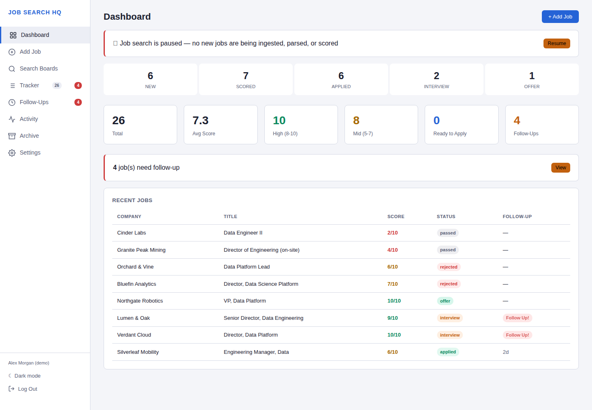
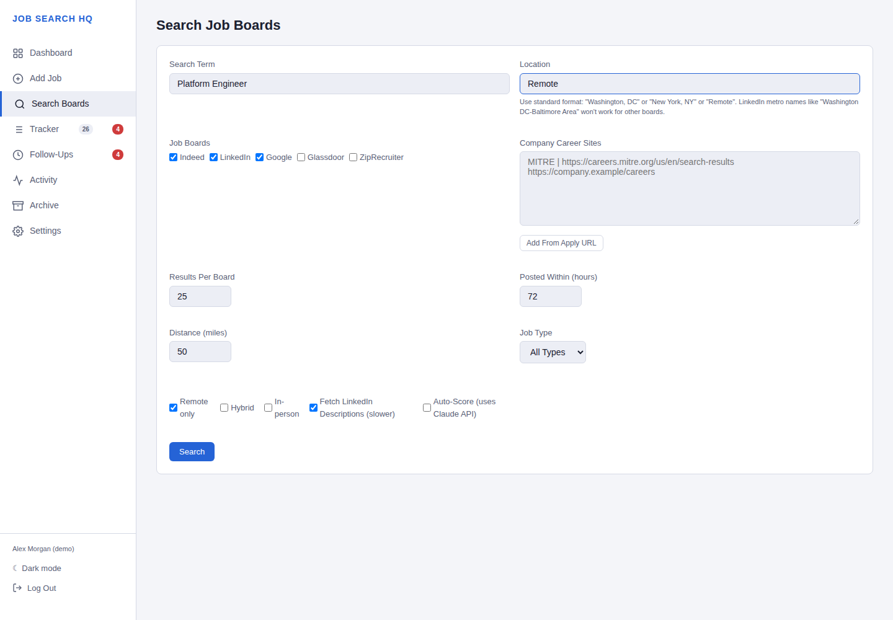
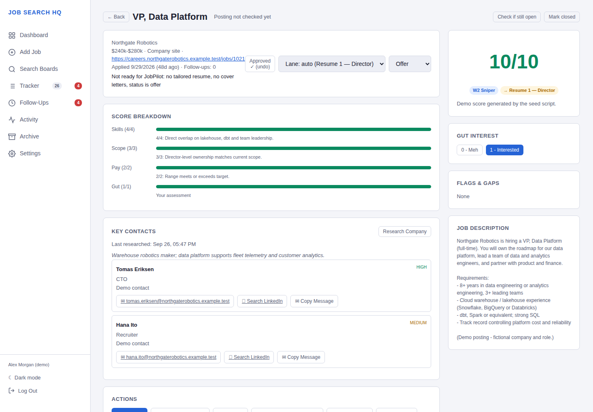
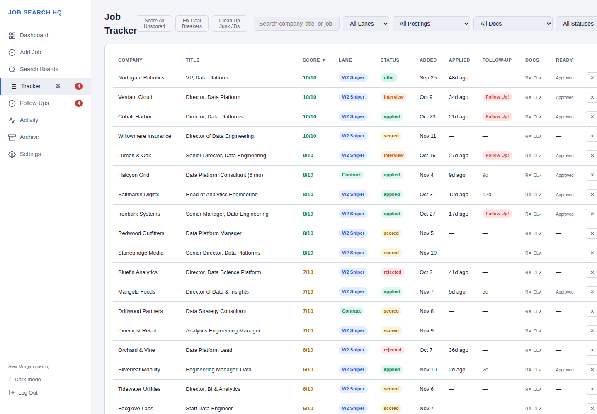

# Job Search HQ

<p align="center">
  
</p>

Job Search HQ (JSHQ) is a self-hosted workspace for finding jobs, evaluating fit, preparing application documents, and tracking outcomes and follow-ups. Run it with Docker Compose and configure your search, profile, and AI providers in the browser.

  

## What you can do

- **Find and capture jobs.** Search Indeed, LinkedIn, Google, Glassdoor, and ZipRecruiter through [JobSpy](https://github.com/speedyapply/JobSpy), add company career sites, or bring in individual jobs by URL, email, or manual entry. Manual board searches run in the background with status per board. Stop a search at any time and keep the jobs already imported.
- **Score and prioritize.** Score jobs against your work history, role scope, compensation targets, and interest. Review the score breakdown on the job page or batch score the tracker.
- **Research companies and manage contacts.** Find relevant contacts from a job page. The optional Network directory lets you preview a LinkedIn connections CSV import, search contacts, add notes, resolve possible duplicates, and export or delete imported data. The directory is off by default.
- **Prepare application documents.** Generate a tailored résumé and up to three cover-letter variants as Word files. Choose among uploaded résumé variants, apply your own Word template, and use optional writing samples to guide tone and style.
- **Track applications and follow-ups.** Filter the tracker by résumé lane, posting status, application status, or document readiness. Check whether a job is still open, archive closed postings, and manage reminders when an application is marked applied. Optional Gmail integration sends application emails and processes supported confirmation and rejection messages.
- **Automate repeat work.** Schedule board and company-site searches, score new jobs, and configure thresholds for document generation, research, and approval. The tracker shows which documents are available and which jobs are ready to apply.
- **Set up your account.** The first-login wizard covers profile, résumé, AI provider, and job preferences. Reopen it from **Settings → Account**. In **Settings → Profile**, you can record language proficiency and choose Light, Dark, or Match device.

## Screenshots

Screenshots use fictional jobs and contacts from the demo tenant.

<p align="center">
  <br>
  <em>Dashboard — pipeline funnel, score distribution, recent jobs at a glance</em>
</p>

<p align="center">
  <br>
  <em>Search Boards — choose job boards, company career sites, and work-arrangement filters</em>
</p>

<p align="center">
  <br>
  <em>Job Detail — fit score, document readiness, and company research contacts</em>
</p>

<p align="center">
  <br>
  <em>Tracker — filter by résumé lane, posting status, and document readiness, and see application follow-ups</em>
</p>

## Quick start

Requires Docker with the Compose plugin.

```bash
git clone https://github.com/smaniktahla/jobsearchHQ.git
cd jobsearchHQ
docker compose up -d --build
```

1. Open [http://localhost:8094/setup](http://localhost:8094/setup) and create the first admin account.
2. Use the first-login wizard to enter your profile, add a résumé, choose AI providers, and set job preferences.
3. Run a search from **Search Boards** or add a known listing through **Add Job**. Open it in the tracker to score it, research the company, or generate documents.

The supplied Compose file mounts `./data` for persistent settings, jobs, and generated documents. Back up this directory to preserve your workspace. For a network-accessible first launch, set `JSHQ_SETUP_TOKEN` in the **container environment** through a Compose override or your deployment configuration before exposing the service. The setup form then requires that token.

### AI providers

Choose Anthropic, Google Gemini, OpenAI, or an Ollama endpoint in **Settings → AI**. The **Fast** tier handles tasks such as scoring and metadata extraction. The **Strong** tier handles drafting work such as résumés, cover letters, and outreach messages. The settings page includes setup instructions and connection tests.

For an Anthropic deployment-wide default with the supplied Compose file, copy `.env.example` to `.env`, set `ANTHROPIC_API_KEY`, and run `docker compose up -d` to apply the new container environment. You can also configure provider credentials in the app. Company research has its own web search workflow described below.

### Accounts and sign-in

JSHQ supports local accounts with per-user data and optional OIDC single sign-on. For an additional sign-in hostname, configure `oidc_extra_hosts` in `data/system_config.json` and register its callback URL with your identity provider.

## JobPilot integration

JSHQ works hand-in-hand with JobPilot to automate the other half of your job search: the painful process of applying for jobs!

JSHQ prepares the application package and exposes its ready-to-apply queue. JobPilot can read the applicant profile, retrieve the résumé and cover letter, and record the outcome of an application attempt back in JSHQ. The agent API requires an `X-API-Key` and operates on the configured admin's data.

## Scoring Rubric

| Dimension | Range | What it measures |
|-----------|-------|-----------------|
| Skills Match | 0–4 | Hard skill overlap with JD |
| Scope/Impact | 0–3 | Seniority and leadership fit |
| Pay Alignment | 0–2 | Comp range vs your targets |
| Gut Interest | 0–1 | Your manual assessment |

The scorer also picks a résumé lane (director, base, or contract) for each job: which of your uploaded résumés fits the role best. You can override it on the job detail page and filter the tracker by résumé lane.

## Company research

On a job detail page, select **Research Company** to look up the official company domain and relevant people. Results can include names, roles, relevance notes, and LinkedIn search links. Research uses Claude web search and can fall back to SearXNG and a local model when configured. Results depend on the sources available for each company.

## Job board coverage

JobSpy queries the boards selected on the **Search Boards** page. Availability, detail, and result counts depend on the source and query. The search view shows per-board failures and empty results. Company career sites can also be configured for manual and scheduled searches.

## API overview

Browser endpoints use the signed-in session. Agent endpoints accept an `X-API-Key` and use the configured admin's data.

| Workflow | Method and endpoint |
| --- | --- |
| Search | `POST /api/search/start`, `GET /api/search/status/{task_id}`, `POST /api/search/cancel` |
| Job intake and tracker | `POST /api/intake`, `GET /api/jobs`, `GET/PATCH /api/jobs/{job_id}` |
| Score and research | `POST /api/jobs/{job_id}/score`, `POST /api/jobs/{job_id}/research` |
| Generate documents | `POST /api/jobs/{job_id}/generate-docs` |
| Account profile | `GET/PUT /api/profile` |
| Follow-ups | `GET /api/follow-ups`, `POST /api/jobs/{job_id}/mark-followed-up` |
| Scheduler | `GET /api/scheduler/status`, `POST /api/scheduler/run-now` |
| Agent job intake | `POST /api/agent/intake` |
| Agent queue and profile | `GET /api/agent/ready-queue`, `GET /api/agent/profile` |
| Agent application handoff | `GET /api/agent/jobs/{job_id}/package`, `POST /api/agent/jobs/{job_id}/application-result` |

See [`main.py`](main.py) for the route definitions and [`network/api.py`](network/api.py) for the Network directory API.

### Agent job intake

Send `POST /api/agent/intake` with the `X-API-Key` header and a JSON body containing
`source`, `title`, `company`, `origin` (a free-text audit label), and at least one
of `url` or `raw_input` (the job description). Include `apply_url` and
`requisition_id` when available. Use `source: "url_scrape"` to fetch the posting
when supplying a URL alone.

New jobs start pending review. The endpoint returns HTTP 200 with
`{"created": true, "id": "..."}`. A match by URL or title and company, including
archived jobs, returns HTTP 200 with
`{"created": false, "id": "...", "reason": "duplicate", "status": "...", "review_status": "..."}`.
Repeating a submission returns the existing job without adding another audit entry.

## Repository layout

| Area | Entry points |
| --- | --- |
| Web app and API | [`static/index.html`](static/index.html), [`main.py`](main.py) |
| Search and scheduling | [`jobspy_search.py`](jobspy_search.py), [`company_site_search.py`](company_site_search.py), [`scheduler.py`](scheduler.py) |
| AI and documents | [`ai_router.py`](ai_router.py), [`scoring.py`](scoring.py), [`docx_builder.py`](docx_builder.py) |
| Accounts and storage | [`auth.py`](auth.py), [`local_users.py`](local_users.py), [`storage.py`](storage.py) |

## Tech Stack

- **Backend:** FastAPI (Python 3.11)
- **Frontend:** Vanilla HTML/JS/CSS (no build step)
- **AI:** Anthropic, Google Gemini, OpenAI, and Ollama through a shared provider interface
- **Scraping:** [python-jobspy](https://github.com/speedyapply/JobSpy)
- **Documents:** python-docx
- **Storage:** JSON files (no database)
- **Auth:** Local accounts (scrypt) with optional OIDC SSO
- **Deploy:** Docker + APScheduler

## Acknowledgments

- **[JobSpy](https://github.com/speedyapply/JobSpy)** by [speedyapply](https://github.com/speedyapply) — Multi-board job scraping. MIT licensed.
- **[Anthropic Claude API](https://www.anthropic.com)** — AI scoring, research, resume tailoring, cover letter generation.
- **[python-docx](https://python-docx.readthedocs.io/)** — Word document generation.

## License

MIT

## Optional: in-app feedback
The Help drawer can offer three buttons (**I need more help**, **Something isn't right**, **I have an idea**) that send a
message to a ticket service. It is off unless both variables are set (put them in `.env`; `docker-compose.yaml` passes them through):

| Variable | Meaning |
|---|---|
| `ATQ_TICKETS_URL` | Base URL of the ticket service, for example `http://tickets.example:8700` |
| `ATQ_TICKETS_TOKEN` | Bearer token that service issued for JSHQ |
| `JSHQ_FEEDBACK_PROJECT` | Optional project label on each ticket (default `jobsearchHQ`) |

The service must provide `POST /tickets` (multipart: `type`, `title`, `body`, `requester_ref`, `requester_contact`, `project`,
`context`, optional `screenshot`) and `GET /tickets/mine?requester_ref=...`. JSHQ keeps no copy of messages: they are forwarded.
The requester is taken from the signed-in session, so people only ever see their own tickets. Failures never expose the
service's address or token to the browser.
